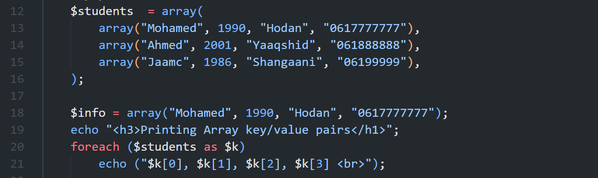
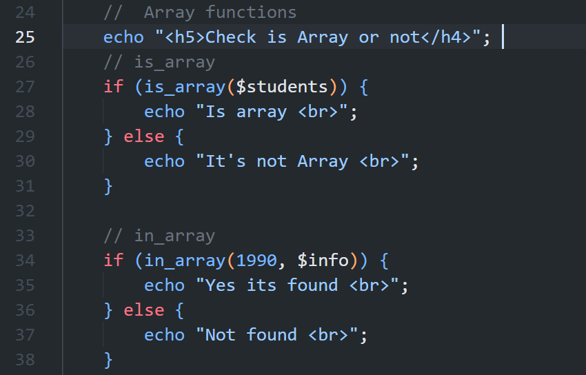
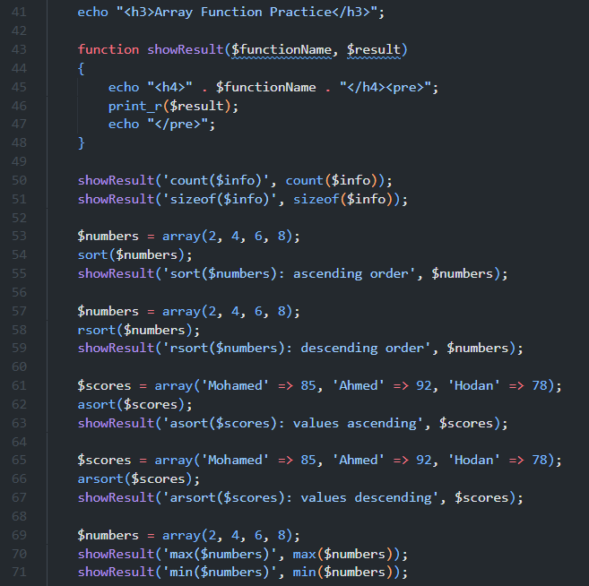
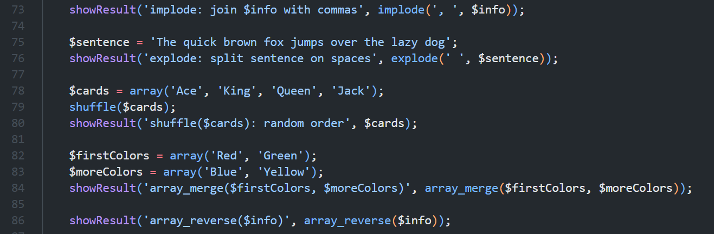
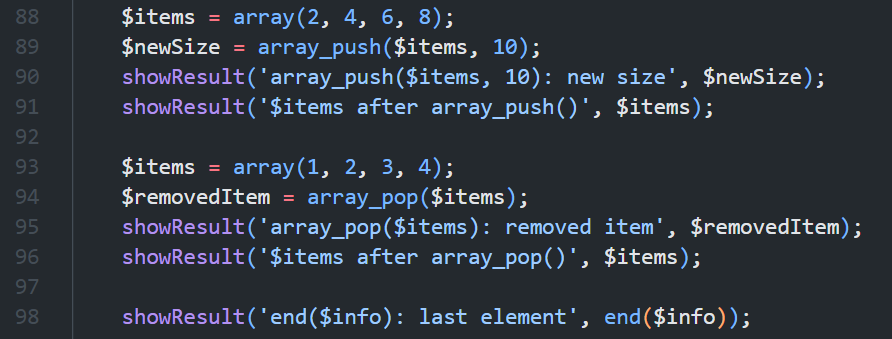

# Week 3: Arrays and Array Functions

This folder is for screenshots of the Week 3 examples in [`index.php`](../index.php). Capture the relevant code and its browser output together where practical. The line ranges below refer to the current `index.php`; include the section heading and complete example in each capture.

## 1. Multidimensional student array

**Suggested filename:** `PHP_Multidimensional_Arrays.png`  
**Capture scope:** `index.php`, lines 12-21

Include the `$students` array, the `$info` array, and the `foreach` loop that prints each student's values. The output should show all three student records.

## 2. Checking arrays and values

**Suggested filename:** `PHP_Array_Checks.png`  
**Capture scope:** `index.php`, lines 24-38

Include the `is_array($students)` check and the `in_array(1990, $info)` check, with their matching output.

## 3. Counting, sorting, and finding values

**Suggested filename:** `PHP_Array_Count_Sort_Min_Max.png`  
**Capture scope:** `index.php`, lines 41-71

Include the `showResult()` helper and examples of `count()`, `sizeof()`, `sort()`, `rsort()`, `asort()`, `arsort()`, `max()`, and `min()`. Keep the code and corresponding results readable; split this into two captures if needed.

## 4. Transforming and combining arrays

**Suggested filename:** `PHP_Array_Transformations.png`  
**Capture scope:** `index.php`, lines 73-86

Include the `implode()` and `explode()` examples, plus `shuffle()`, `array_merge()`, and `array_reverse()`. The order from `shuffle()` is random and may differ each time.

## 5. Adding, removing, and reading array elements

**Suggested filename:** `PHP_Array_Stack_Operations.png`  
**Capture scope:** `index.php`, lines 88-98

Include `array_push()` and `array_pop()`, their return values and updated arrays, and `end($info)` for reading the last element.

