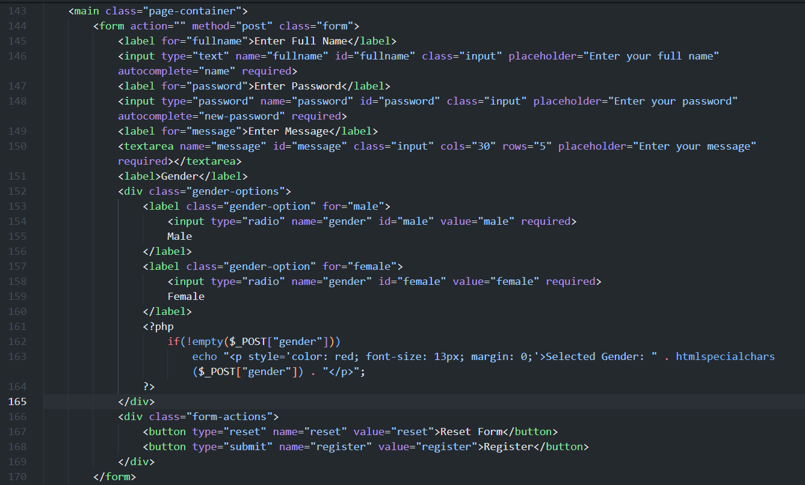
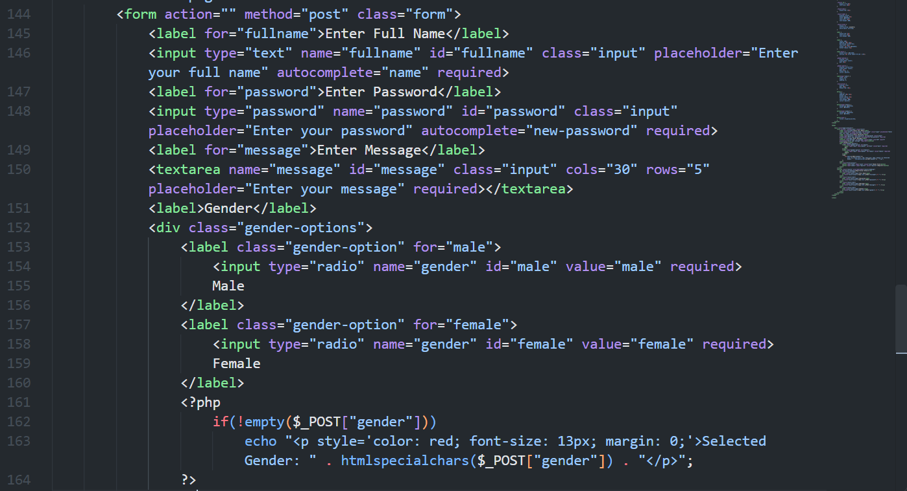
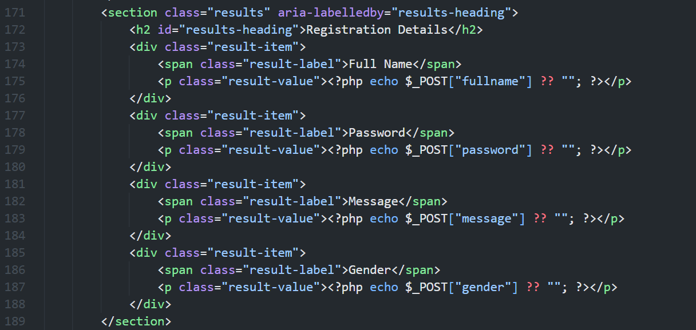
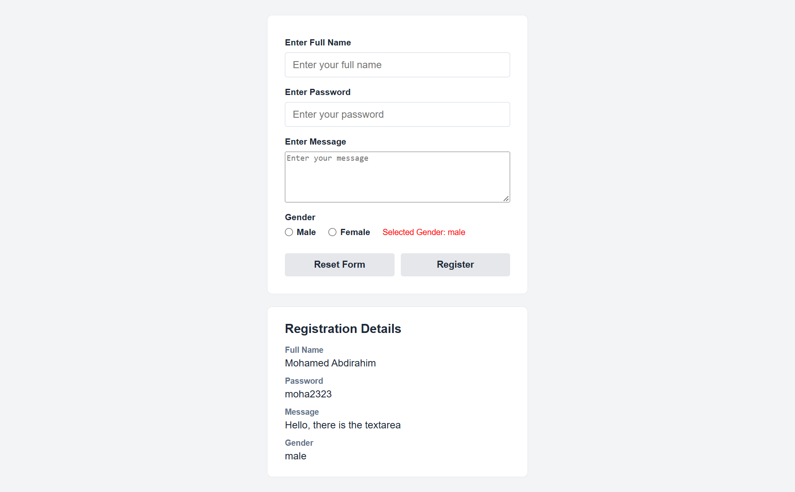

# Week 4: HTML Forms and PHP Form Processing

This folder is for screenshots of the form example in [`index.php`](../index.php). The line ranges below refer to that file. For browser screenshots, run the page through XAMPP/Apache, not as a local file. Use fictional sample data only.

## 1. Registration form and controls

**Suggested filename:** `PHP_Form_Controls.png`  
**Capture scope:** `index.php`, lines 143-170

Show the form with the full-name text field, password field, message textarea, gender radio buttons, and Reset Form/Register buttons. A browser capture of the form before submission is suitable.

## 2. Form submission and selected gender

**Suggested filename:** `PHP_POST_Form_Submission.png`  
**Capture scope:** `index.php`, lines 144-164

Include the form's `method="post"`, the controls' `name` attributes, and the PHP check that reads `$_POST["gender"]`. This demonstrates how a submitted control name is used as a `$_POST` key.

## 3. Submitted registration details

**Suggested filename:** `PHP_Form_Submitted_Results.png`  
**Capture scope:** `index.php`, lines 171-189

Show the Registration Details section and the PHP expressions that display the submitted name, password, message, and gender. If capturing the running page, use a made-up password; this practice page displays the password value.

## 4. Complete form interaction

**Suggested filename:** `PHP_Registration_Form_Demo.png`  
**Capture scope:** Browser view after submitting the form in `index.php` (lines 143-189)

Capture the form and its results panel together after entering fictional values and selecting one gender option. This shows the full browser-side interaction from controls to displayed POST results.

