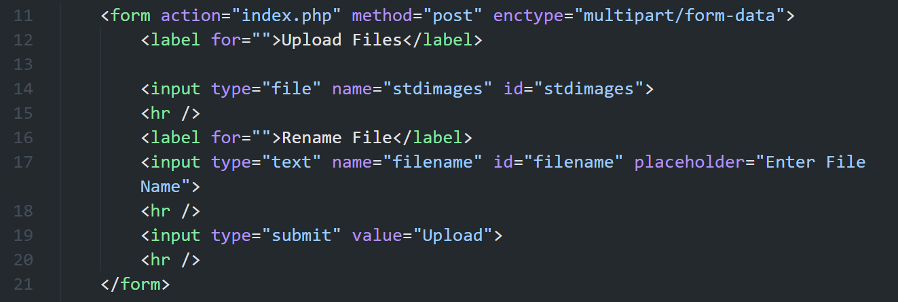
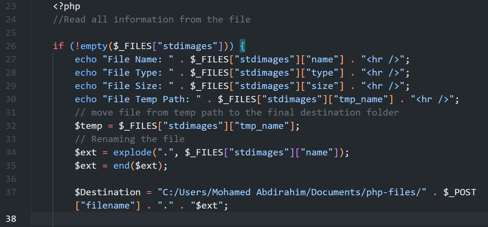
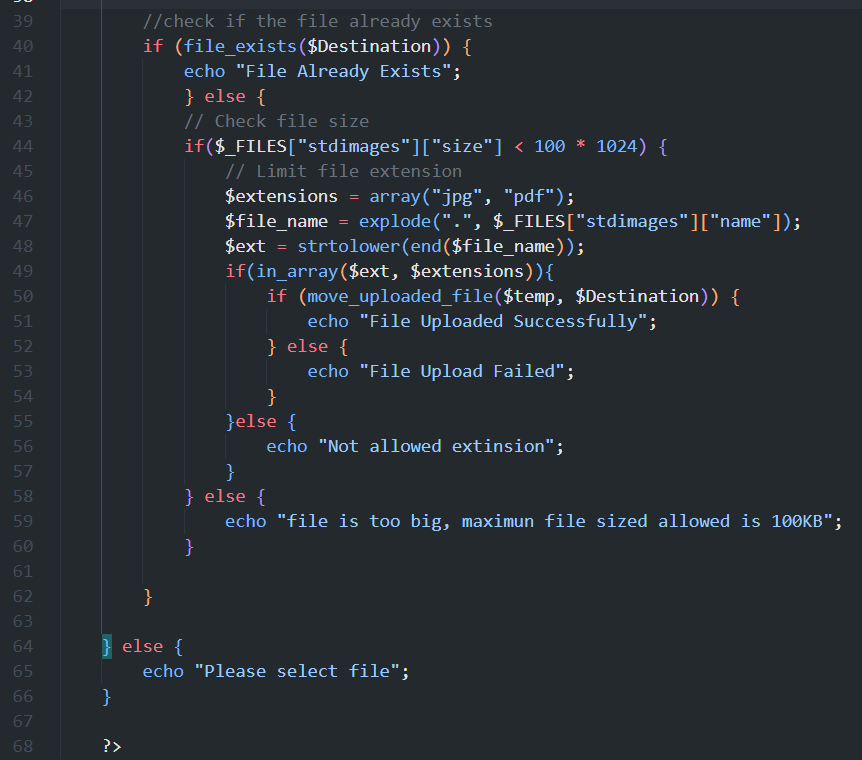

# Week 5: File Upload Screenshots

These screenshots document the file upload example in [`../index.php`](../index.php). Include readable code and the related browser output where practical. The line ranges below refer to the current `index.php`.

## 1. Upload form

**Suggested filename:** `PHP_File_Upload_Form.png`  
**Capture scope:** `index.php`, lines 11-21

Show the multipart POST form, file picker, new filename field, and Upload button. The browser view should show the empty form before submission.

## 2. Uploaded file information and destination name

**Suggested filename:** `PHP_File_Upload_Information.png`  
**Capture scope:** `index.php`, lines 23-38

Show how PHP reads the uploaded file from `$_FILES`, displays its original name, type, size, and temporary path, then builds the destination filename using the submitted new name and original extension.

## 3. Upload checks and result

**Suggested filename:** `PHP_File_Upload_Validation.png`  
**Capture scope:** `index.php`, lines 39-66

Show the existing-file check, the 100 KB size limit, allowed `jpg`/`pdf` extensions, and the success/failure messages. If capturing browser output, include a successful allowed upload; optionally capture a separate rejection result for a file that is too large, has a disallowed extension, or already exists.

## Screenshot setup

The example saves files to `C:/Users/Mohamed Abdirahim/Documents/php-files/`. Create that folder or update the destination path in `index.php` before testing. For the successful-upload screenshot, use a `.jpg` or `.pdf` smaller than 100 KB and provide a new base name that does not already exist in the destination folder.